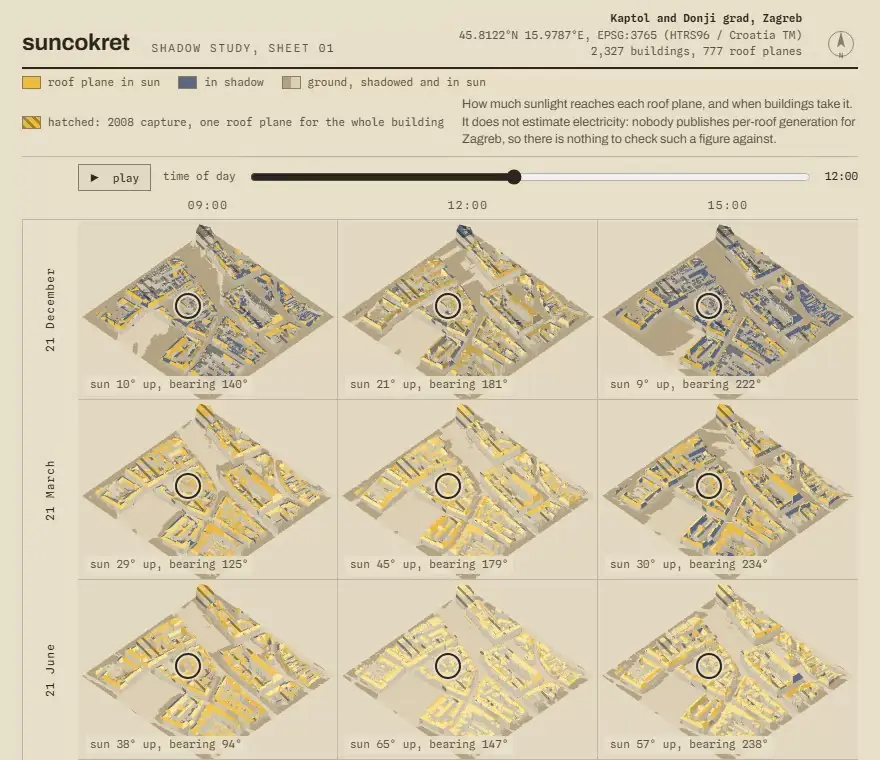

# suncokret

A shadow study of a few blocks of central Zagreb, drawn from the city's own 3D
model of its buildings. Live at https://suncokret.vercel.app.

[](https://github.com/markolivaic/suncokret/actions/workflows/ci.yml)

[](docs/walkthrough/app-walkthrough.mp4)

The page draws the blocks from Trg bana Jelačića down to Zrinjevac nine times:
at 09:00, 12:00 and 15:00, on 21 December, 21 March and 21 June. Every roof
plane comes from ZG3D 2022, which the city describes as a LoD 2.2 model, and is
coloured by whether the sun reaches it at that moment. A slider moves all nine
drawings through the day. Selecting a roof shows its year underneath, hour by
hour, with the hours its neighbours take marked in blue.

Irradiance is one year of hourly data for Zagreb, 2020, from PVGIS, the
European Commission's solar radiation service. For each roof the page gives the
sunlight arriving on it in kWh/m² a year, ranks the roofs by it, and gives the
share of that sunlight the surrounding buildings leave. It does not estimate
electricity. Nobody publishes per-roof generation for Zagreb, so there would be
nothing to check such a figure against.

ZG3D is uneven. 194,967 of its 357,683 buildings (54.5%) come from a 2008
aerial capture with a median of 6 faces per building, and 56% of those have a
single roof face for the whole roof. The other 161,872 (45.3%) come from a 2022
multisensor capture with a median of 72. Both the drawing and the year view
hatch the single-plane buildings. In the published district, a 260 m square,
46 of the 777 selectable roof planes belong to such buildings.

## Quick start

The district bundle is committed and the page is static.

```bash
cd web && npm ci && npm run dev
```

Open the URL it prints.

## Prior work, and what is different here

Shading from neighbouring buildings is well covered. ArcGIS's solar radiation
tools (Fu and Rich, 2002), r.sun run over 3D city models (Hofierka and Kaňuk,
2009) and SEBE in UMEP (Lindberg et al., 2015) all compute it, and the City of
Zagreb and REGEA released a Solar PV Potential tool in 2022 that accounts for
nearby buildings on the same city model. This project is narrower. It rebuilds
from public data with the scripts below, it shows when in the day and the year
a roof is shaded as well as how much, and it marks on every building how coarse
the model is there.

## From multipatch to sunlight

    data.zagreb.hr           ZG3D 2022, file geodatabase, Esri multipatch
        |
        |  scripts/fetch_zg3d.py
        v
    backend/suncokret/wkb.py         normalise the WKB flavours GDAL emits
    backend/suncokret/roofs.py       rings -> oriented planes, tilt, azimuth
        |
        |                    re.jrc.ec.europa.eu  PVGIS hourly, one call
        |                        |  scripts/fetch_pvgis.py
        v                        v
    backend/suncokret/shading.py     horizon profile per plane
    backend/suncokret/sun.py         solar position
    backend/suncokret/irradiance.py  transpose, block beam, reduce diffuse
        |
        |  scripts/build_district.py
        v
    web/public/district/*.json + .bin
        |
        v
    web/src  three.js, nine scissored viewports over one scene

Orientation comes from the highest face of each building. A roof plane and the
floor slab under it are both horizontal, so forcing normals upward turns a
floor into a second roof. The sign of the divergence-theorem volume would say
which way is out, but only for a closed surface, and 54% of ZG3D is open shells
with no floor whose signed volume misses the dataset's own `Volume` attribute
by a median factor of 14.8. The highest non-vertical face needs no closure. On
the closed solids, where the volume sign can be checked, the two rules agree.

Blockers lower than the roof are dropped before the horizon is built. The
horizon is only consulted at positive sun elevations, where a lower neighbour
cannot block anything, so this changes no result and leaves far fewer points
to project.

Beam and diffuse are shaded separately. Beam is switched off hour by hour when
a building stands between the roof and the sun, checked once an hour at the
minute PVGIS stamps its hourly values (ten past). Diffuse comes from the whole
sky and is reduced by the share of sky the buildings cover, in every hour. In
2020, 41% of the sunlight on a horizontal surface in Zagreb was diffuse.
Treating it as unobstructed would overstate what the most shaded tenth of this
district's roofs keep by 0.123 on average.

The browser side is plain TypeScript on Vite with three.js. Nine viewports are
scissored out of one scene and redrawn together on each step of the sweep.

## One bug, fixed twice

The page once showed a roof keeping 0.91 of its irradiance and ranked 1 of 777
at the same time, when the ranking was by that same share. At the time 327 of
the 777 planes scored exactly 1.0, so a roof at 0.91 could not have been first.
I did not find this by testing. I found it by looking at the running page and
noticing two numbers that contradicted each other. These figures are
historical: the code that produced them no longer exists.

The cause was a guard written `x / y if y > 0 else 1.0`. Flat planes carried a
NaN azimuth, the NaN reached the incidence term, and `NaN > 0` is false, so the
fallback read a missing denominator as nothing lost.

The first fix went into the module the district build uses and stopped there.
The four-district shading benchmark scored roofs with its own copy of the same
arithmetic and the same guard, so every flat roof in it still scored 1.0. It
also counted hours with the sun below the horizon in the denominator, which a
roof can only lose. The two errors pulled in opposite directions. Travno,
mostly flat-roofed slabs, read 0.994 at the time and looked like the least
shaded district, while pitched roofs everywhere looked more shaded than they
are.

Every script now scores a roof through one function, `shade_plane`, which
refuses a non-finite orientation, counts beam only while the sun is up, and
weights it by direct normal irradiance. A near-flat roof keeps its measured
azimuth. The district's mean kept is 0.933 and its median 0.979, from
`data/survey/district_build.json`, and the browser recomputes the same year for
every roof to within 0.001 of the build.

## Checked against the data

Every building in ZG3D, 357,683 swept in 292 s, one row each, including the
ones that fail:

| | buildings | share |
|---|---|---|
| has a roof face, tilt 60° or less | 354,927 | 99.23% |
| has pitched roof modelling | 257,792 | 72.07% |
| enough roof for a domestic install | 231,218 | 64.64% |

The 60° cut is the one judgement call in that table; `roof_survey.json` gives
the domestic-install count at 45° and 75° as well.

The extracted geometry is checked against ZG3D's own attributes. Of the 163,325
buildings that close into solids, 42 have no positive `SArea` and are skipped.
On the other 163,283 the sum of computed face areas matches `SArea` to a median
relative error of 2.8e-06. 1,933 disagree by more than 1%, and 1,927 of those
have an `SArea` smaller than the surface of a sphere holding the building's own
`Volume`, which no solid can have, so there the attribute is wrong rather than
the geometry. The survey lists the worst ten. 36.7% of all 23,767,453 faces
have zero area and are discarded; 671 buildings ship geometry shapely will not
parse and are repaired; 148 have no non-vertical face and their orientation is
left undecided.

Solar position agrees with the sun elevation PVGIS reports for each of 4,289
daylight hours of 2020 to RMS 0.204°, maximum 0.425°, at the raw timestamp with
no offset fitted.

Twenty roof planes, from the most shaded to the least, were sent to PVGIS with
their own horizon profiles. Given the same horizon, PVGIS and this project
agree on beam kept to RMS 0.005, and at most 0.018 apart. PVGIS takes one
horizon value per degree and interpolates between them, which fills narrow gaps
between buildings; on these planes that alone moves beam kept by up to 0.160
against the half-degree profile the bundle uses. With no horizon the
plane-of-array totals agree to 0.4%. With the horizon on, this project's totals
are 5.9% lower; beam agrees, so the difference is in how the diffuse sky is
shaded.

`web/src/sun.ts` is a port of `backend/suncokret/sun.py`, checked in CI against
140 reference cases generated by the Python module.

Shading costs 8.8 to 39.4 ms per building, depending on density, with five
sample points per roof. Beam kept is the share of the direct sun a building's
largest roof plane would get with the city removed that still reaches it. In
dense Donji grad the mean is 0.939, the worst tenth keep 0.809 or less, and the
worst keeps 0.536. Trešnjevka: mean 0.978, worst 0.769. Travno, widely spaced
slabs: mean 0.975, worst 0.634. Suburban Sesvete: mean 0.988, worst 0.833.

Lifting every building into a box at its highest face, roughly what an LoD1
model gives, changes beam kept in Donji grad by -0.025 on average and by up to
0.216 for one roof; 633 of 1,016 roofs move by more than 1%.

Both shading approximations are measured on 500 buildings in each of Donji grad
and Trešnjevka. A 1 m blocker height field moves beam kept by 0.0051 and 0.0020
on average against the undecimated cloud, and 5 m by 0.047 and 0.016. Flat
roofs are the more sensitive: at 1 m their mean error is 0.0064 and 0.0033,
against 0.0043 and 0.0014 for pitched ones. A 250 m search radius differs from
500 m by 0.0000 and 0.0003.

## Rebuilding it

Development is on Windows and CI is on Linux.

```bash
python -m venv .venv
. .venv/bin/activate          # Windows: .venv\Scripts\activate
pip install -r requirements.lock
pip install --no-deps -e backend
python scripts/fetch_zg3d.py        # about 329 MB
python scripts/fetch_pvgis.py
python scripts/fetch_osm_streets.py
python scripts/survey_roofs.py      # about 5 minutes, resumable
python scripts/validate_sun.py
python scripts/benchmark_shading.py # about 11 minutes
python scripts/build_district.py    # about 4 minutes
python scripts/crosscheck_pvgis.py  # 40 requests to PVGIS
```

| Script | What it does | Writes |
|---|---|---|
| `scripts/fetch_zg3d.py` | Downloads the ZG3D file geodatabase | `data/raw/` |
| `scripts/fetch_pvgis.py` | One PVGIS call, hourly components for Zagreb | `data/pvgis/` |
| `scripts/fetch_osm_streets.py` | Named streets around the district, from OpenStreetMap | `data/osm/streets.json` |
| `scripts/survey_roofs.py` | Sweeps all 357,683 buildings | `data/survey/roof_survey.json` |
| `scripts/validate_sun.py` | Solar position against PVGIS, hour by hour | `data/survey/sun_validation.json` |
| `scripts/benchmark_shading.py` | Cost and effect of shading over four districts | `data/survey/shading_benchmark.json` |
| `scripts/build_district.py` | The bundle the page reads | `web/public/district/`, `data/survey/district_build.json` |
| `scripts/crosscheck_pvgis.py` | 20 horizon profiles sent to PVGIS | `data/survey/pvgis_crosscheck.json` |

Every measured number in this README comes from one of those files, and
`tests/integrity` fails if one drifts. The figures from before the bug fix are
marked as historical.

There are 82 Python tests and 16 TypeScript tests, one of which runs the 140
reference cases.

```bash
pytest tests/unit
pytest tests/integrity
cd web && npm test
npm run build && npm run check:layout    # needs: npx playwright install chromium
```

The walkthrough above is recorded from the production build by
`npm run walkthrough` in `web/`, which needs ffmpeg and the same Chromium.

## What it leaves out

- Ground truth. No roof in Zagreb has published generation to compare with.
- Separate self-shading. A plane's own building is in its blocker set, which is
  right for a dormer and wrong for the plane's own edge. Blockers nearer than
  1.5 m are dropped.
- Shading of reflected irradiance, which is a few per cent of the total.
- An anisotropic sky. The diffuse model is isotropic, which understates losses
  to buildings on the south side and overstates them to the north.
- More than one year of weather. A different year moves every absolute figure;
  how much it moves the ranking is not measured.
- Trees. ZG3D ships them and this uses only buildings. The south end of the
  district reaches Zrinjevac, a square lined with mature plane trees, so roofs
  facing it are scored as more open than they are.
- More than one sample point per roof in the bundle. Against five points, on 200
  of the 777 planes, kept differs by 0.0022 on average and 0.023 at worst,
  measured on every build.
- Terrain. The ground under the drawing is one level plane at the median base
  of the buildings.

## Why this exists

I wrote the shadow geometry once before, for a 48 hour hackathon project called
[sada](https://github.com/markolivaic/sada), which used SunCalc and Turf.js over
the same Zagreb LiDAR to tell you which cafe terrace was in the sun. It worked.
I wanted to know what that machinery is worth pointed at a decision that costs
money instead of at where to have coffee.

Zagreb is the one place I can get this data. ZG3D is published under an open
licence with real roof planes in it, which most cities do not do, and I can check
the answers against streets I have walked down.

## Sources

- ZG3D 2022, 3D model of the City of Zagreb, Grad Zagreb, Otvorena dozvola.
  https://data.zagreb.hr/dataset/zg3d-2022-3d-model-gz
- PVGIS, European Commission Joint Research Centre. https://re.jrc.ec.europa.eu/
- OpenStreetMap contributors, street names, Open Database License 1.0.
  https://www.openstreetmap.org/copyright
- NOAA Solar Calculator, the abridged Meeus series `sun.py` implements.
  https://gml.noaa.gov/grad/solcalc/
- Fu, P. and Rich, P. M. (2002). A geometric solar radiation model with
  applications in agriculture and forestry. Computers and Electronics in
  Agriculture 37, 25-35.
- Hofierka, J. and Kaňuk, J. (2009). Assessment of photovoltaic potential in
  urban areas using open-source solar radiation tools. Renewable Energy 34(10),
  2206-2214. https://doi.org/10.1016/j.renene.2009.02.021
- Lindberg, F., Jonsson, P., Honjo, T. and Wästberg, D. (2015). Solar energy on
  building envelopes: 3D modelling in a 2D environment. Solar Energy 115,
  369-378.
- City of Zagreb and REGEA, Solar PV Potential tool (2022), as described by
  ManagEnergy, 6 June 2023.
  https://managenergy.ec.europa.eu/managenergy-discover/managenergy-news/zagrebs-smart-energy-solutions-citizens-2023-06-06_en
- What was done to each dataset: [THIRD_PARTY_NOTICES.md](THIRD_PARTY_NOTICES.md)

## License

MIT, see [LICENSE](LICENSE). The data keeps its own licences, listed in
[THIRD_PARTY_NOTICES.md](THIRD_PARTY_NOTICES.md).
